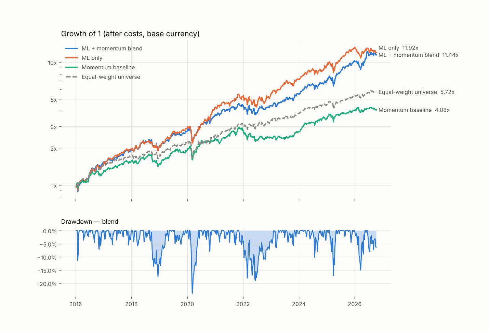
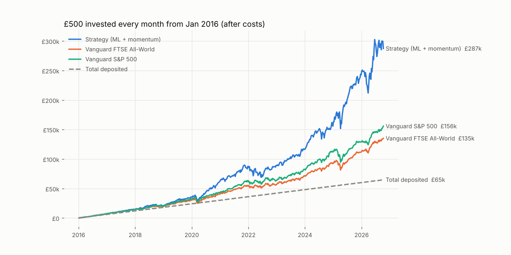

# Weekly Global Equity Strategy — Plan

## 1. Goal and constraints

| Item | Decision |
|---|---|
| Asset class | Global listed equities (US, UK, Europe, Switzerland; Nordics/Canada via IBKR) |
| Capital | 10,000 for the test phase |
| Brokers | Trading 212 or Interactive Brokers (switch in `config.yaml`) |
| Frequency | Weekly. Signal on Friday's close, orders placed by hand on Monday |
| Direction | Long-only (no shorting, no leverage, no derivatives) |
| Execution | Manual, from an order sheet the system writes each week |

## 2. Approach: an ML model at the core, news and events as features later

The core is a **cross-sectional ranking model**. Each week it scores every stock in the universe
on how likely it is to beat the others over the next week. We buy the top names.

Why not an LLM agent that reads the news and decides the trades?

- **It can't be backtested honestly.** An LLM already knows what happened after its training data
  started, so a historical test of a news-reading agent leaks the future.
- **Headline news is priced in within minutes.** A weekly strategy can't beat that.
- **Its decisions vary from run to run**, which makes them hard to audit or explain.

News and event analysis *is* useful for slower information: earnings-call tone, guidance
changes, filing language, M&A or litigation flags. It enters in Phase 4, as timestamped
numeric features that the ML model can weigh and the backtest can test.

## 3. Architecture

```
            ┌──────────────┐   prices, volume, FX (Yahoo Finance, free)
            │ wq/data.py   │── cached as parquet in data/cache/
            └──────┬───────┘
                   ▼
            ┌──────────────┐   15 price/volume features, ranked across stocks each week
            │ features.py  │── labels: next-week return rank (exec Monday → next Monday)
            └──────┬───────┘
                   ▼
            ┌──────────────┐   LightGBM, walk-forward: retrain every week on a rolling 5 years,
            │ model.py     │── blended 70/30 with a transparent momentum baseline
            └──────┬───────┘
                   ▼
            ┌──────────────┐   top-15, hold band, country cap, regime filter,
            │ portfolio.py │── lot sizes / fractional shares, minimum trade size
            │ costs.py     │── broker commissions, FX fees, stamp duty, slippage
            └──────┬───────┘
          ┌────────┴─────────┐
          ▼                  ▼
   backtest.py          weekly.py
   (history)            (this week's orders.csv + report.md)
```

The backtest and the live run call **the same** selection, ordering and cost functions, so the
backtest simulates the rules you will actually trade.

## 4. Data

**Now (free):** Yahoo Finance via `yfinance`, with adjusted daily prices, volume and FX rates
back to 2010. No API key is needed.

Known limitations, which the plan accounts for:

1. **Survivorship bias.** The universe is *today's* large caps. A backtest from 2016 therefore
   only contains companies that went on to succeed, which flatters every strategy. To reduce this,
   always compare against the **equal-weight benchmark built from the same universe**, which
   carries the same bias. Treat the strategy's excess return over that benchmark as an upper bound.
2. **No point-in-time fundamentals.** Yahoo's fundamentals are restated and only cover a few
   years, so v1 uses price and volume features only. These are point-in-time by construction.
3. **Unofficial source.** Yahoo can change without notice or return bad prints. The pipeline drops
   single-day 100x spikes, and the order sheet always shows the reference price so you can
   sanity-check it.

**Upgrade path, when the strategy earns it:**

- Survivorship-free US data with delisted stocks: Norgate Data or Sharadar (~$30–60/month)
- Global prices and fundamentals: EODHD or FMP (~$20–80/month)
- Live quotes: IBKR market-data subscriptions, if you trade there

## 5. Features (v1)

Every feature uses data up to the signal date only, and is converted to a percentile rank across
stocks each week.

| Group | Features |
|---|---|
| Momentum | 12-1 month, 6-1 month, 3 month |
| Short-term reversal | 1 week, 1 month |
| Risk | 60-day volatility, 20/120-day volatility ratio, beta, idiosyncratic volatility, 60-day skew, max daily return (21d) |
| Trend | distance from 52-week high, distance from 200-day average |
| Liquidity / attention | log 60-day traded value, 20/120-day traded value trend |

Returns are measured in the **account's base currency**, so FX moves are part of what the
model predicts. A EUR stock that rose 5% while EUR fell 5% is flat for a USD account.

## 6. Model and validation

- **Label:** the cross-sectional rank of each stock's return from Monday's close (the assumed fill)
  to the next Monday's close. The model predicts *relative* performance, not market direction.
- **Walk-forward:** at each week T, train only on labels fully known before T. The test suite
  enforces this embargo.
- **Retraining:** every week, on a rolling 260-week window, with at least 156 weeks of
  history before the first prediction. The backtest and the live run retrain on the same schedule, so
  the backtest simulates exactly what is traded (a test checks the two scores match).
- **Score history:** the live run saves each week's scores and reuses them for the 4-week average, so
  it averages the scores you actually traded on.
- **Seed ensemble:** five LightGBM models trained with different random seeds, predictions averaged.
  A single seed's luck moved backtest CAGR by up to 5 points (see §13).
- **Score smoothing:** each stock's traded score is the average of its last 4 weekly scores. Raw
  weekly scores are noisy, and trading on them replaced half the portfolio every week (see §13).
- **Three variants are reported side by side:** ML only, momentum baseline only, and the blend.
  If ML can't beat the simple baseline after costs, we trade the baseline. That's a valid outcome.
- **Leak tests (in `tests/`):** on synthetic pure-noise prices the model must show no skill.
  With a planted signal it must find it. Changing future prices must not change past features.

**Metrics:** information coefficient (IC: the weekly rank correlation between score and the next
week's return) with its t-stat, CAGR, volatility, Sharpe, max drawdown, turnover, and costs as a
share of capital per year. The strategy is compared with the equal-weight universe (did stock-picking
help?), with buying and holding real index funds (VWRL, VUSA), and with investing £500 a month in them.

## 7. Portfolio rules

| Rule | Default | Why |
|---|---|---|
| Positions | 15, equal weight | ~650 each at 10k. Enough to diversify, few enough to trade by hand |
| Hold band | keep a holding while it ranks in the top 150 (of ~245) | Holdings last ~33 weeks on average; turnover 6%/week |
| Score smoothing | 4-week average of scores | Together with the hold band, cuts costs from 8%/yr to under 1%/yr |
| Country cap | max 6 per country | Avoids a US-only portfolio by accident |
| Sector cap | off by default (`max_per_sector: 15`) | Available: 4 per sector cuts single-sector bets but cost 3%/yr in backtest (§13) |
| Cash buffer | 2% | Covers fees and FX |
| Minimum trade | 75 | Skips trades too small to be worth the costs |
| Drift rule | resize only if >30% off target | Fewer tiny top-ups |
| Regime filter | off by default | Tested: it cost ~3%/yr by missing rebounds and didn't reduce drawdowns (§13) |
| Lots | JP/HK board lots (100+ shares) | These markets are excluded by default because one lot can exceed a position at 10k |

## 8. Costs and broker choice at 10k

| | Trading 212 | IBKR Pro (tiered) |
|---|---|---|
| Commission | 0 | US ~$0.0035/share, min $0.35. EU ~0.05%, min ~€1.25–1.5 |
| FX | 0.15% on each trade in a non-base currency | ~0.002% (min ~$2 per conversion; hold USD/EUR balances) |
| Fractional shares | Most US/EU stocks | US and some EU |
| Universe | US, UK, major EU | Global, including Nordics, Canada, Japan and Hong Kong |
| Taxes (both) | UK stamp duty 0.5%, France FTT 0.3%, Italy 0.1%, Spain 0.2% (on buys) | same |

Rule of thumb: Trading 212 is cheaper when you trade mostly in your account's own currency.
IBKR is cheaper when you trade a lot in other currencies. Run the backtest with each
`broker` setting, since both cost models are built in. Check every number against your own
statements and update `config.yaml`.

## 9. Risk management

- **Position limits:** at most ~6.5% per name. No leverage, no shorting.
- **Sector concentration:** each weekly report shows the sector mix. Momentum piles into hot
  sectors (the Oct 2026 portfolio holds 7 chip stocks), and `max_per_sector` caps it if you prefer
  less concentration than the backtest-optimal setting.
- **Kill switches.** Stop trading and review if any of these happen:
  - drawdown exceeds 20% from the peak
  - live IC is negative on average over 12 consecutive weeks
  - live results trail the backtest by more than 2 standard deviations over 6 months
- **Data checks:** the order sheet shows reference prices. Don't place an order whose price looks
  wrong against the broker's quote.
- **Human in the loop:** you approve every trade.

## 10. Weekly operating routine

1. **Weekend:** run `python -m wq weekly`. It refreshes data, retrains on all realised labels,
   scores the universe and writes `reports/<date>/orders.csv` and `report.md`.
2. **Monday:** place sells first, then buys. Use limit orders a little through the quote.
   London prices are in pence.
3. **After fills:** update `holdings.csv` with the actual shares and your cash balance.
4. **Monthly:** compare live results against the backtest and check the kill switches.

## 11. Roadmap

| Phase | What | Exit criteria |
|---|---|---|
| **0. Build** (done) | Data pipeline, features, walk-forward model, cost-aware backtest, weekly order sheet, tests | Tests pass |
| **1. Real-data backtest** (done, Oct 2026, see §13–14) | Run `download` + `backtest`. Test sensitivity to `n_positions` 10/15/20, `hold_rank` 30/45/60, `ml_weight` 0/0.5/0.7/1, regime filter on/off, and both brokers | **Go** if, after costs: the blend's IC averages >0.02 with t>2, it beats the equal-weight benchmark in most rolling 1-year windows, and results hold across settings (not one lucky parameter set). Otherwise fall back to the baseline or stop |
| **2. Paper trading** (running from 17 Oct 2026, see §15) | 8–12 weeks of weekly runs without money. Record what you *would* have traded and at what prices | Live IC and turnover are in line with the backtest |
| **3. Live, 10k** | Trade the order sheet weekly. Track costs and slippage against the model's estimates | Kill switches not hit. Costs close to the model's estimates |
| **4. News and event features** | Use the Claude API to score earnings-call transcripts, filings (8-K/10-Q) and news on a timestamped, point-in-time basis. Candidate features: guidance-change score, tone change versus last quarter, event flags (M&A, litigation, management change). Add them as model features and test them only on data dated *after* the scoring model's training cutoff | A feature adds IC out of sample, after the cutoff |
| **5. Better data** | Survivorship-free and point-in-time fundamental data. Add value, quality and earnings-revision factors | Improvement survives the cleaner data |
| **6. Automation** | Generate orders through the IBKR API (`ib_async`), still with human approval. Trading 212 also offers a public API: check availability for your account | Scale capital only after 6+ months of live tracking |

## 12. Honest expectations

- The edge in large-cap weekly stock selection is **small**: a good IC is 0.02–0.05. Most of the
  return comes from staying invested in equities. The model's job is to tilt toward the better names
  without losing the edge to costs.
- Backtests on today's large caps are **optimistic** (survivorship bias). Expect live results
  to be worse.
- At 10k, **costs and FX fees matter**. The hold band and minimum trade size exist for this reason.
- This is a research tool, not investment advice. Results are not guaranteed.

## 13. Phase 1 results (October 2026)

Settings: GBP account, Trading 212 costs, 15 positions, weekly rebalance, signals from Jan 2016 to
Oct 2026 (562 weeks, 245 stocks). All returns are in GBP, after costs.



### What the first run showed

With the original settings (top-45 hold band, raw weekly scores, regime filter on), the strategy
**lost to the benchmark**: 15.6% CAGR against 17.5%. The model had real skill (weekly IC 0.020,
t-stat 2.75). Before costs it made 24.7% a year. But it replaced ~50% of the portfolio every week,
and fees took 7.7% a year. Most trades in a GBP account pay T212's 0.15% FX fee, and UK buys pay
0.5% stamp duty. The regime filter cost a further ~3.4% a year by missing rebounds.

### How the settings were chosen

To avoid fitting the past, settings were chosen on **Jan 2016 – Jun 2024 only**. **Jul 2024 – Oct
2026 was kept as an untouched holdout.** The grid was small (12 combinations): label horizon 1 or 4
weeks, score smoothing 1 or 4 weeks, hold band 45/90/150. The best tuning-period result was
1-week labels, 4-week smoothing and a top-150 hold band. All 12 combinations beat the benchmark's
CAGR on the holdout, so the result does not depend on one lucky setting.

### Results with the chosen settings (5-seed ensemble, weekly retraining)

**Lump sum: £10,000 invested once in January 2016**

| | Final value | CAGR | Volatility | Sharpe | Max drawdown |
|---|---|---|---|---|---|
| **Strategy (70% ML + 30% momentum)** | **£105,545** | **24.4%** | 20.2% | **1.18** | −24.7% |
| ML only | £135,845 | 27.4% | 20.8% | 1.27 | −25.7% |
| Momentum rule only | £40,989 | 14.0% | 15.9% | 0.90 | −23.2% |
| Buy & hold Vanguard S&P 500 (VUSA) | £51,916 | 16.5% | 15.3% | 1.08 | −25.1% |
| Buy & hold Vanguard FTSE All-World (VWRL) | £40,638 | 13.9% | 13.9% | 1.01 | −24.6% |
| Equal-weight stock universe | £57,192 | 17.5% | 14.5% | 1.19 | −27.3% |

**Monthly investing: £500 at the start of every month, Jan 2016 – Oct 2026 (£65,000 deposited)**

| Invested into | Final value | Money-weighted return (XIRR) |
|---|---|---|
| **Strategy** | **£234,329** | **22.4%** |
| Vanguard S&P 500 | £155,767 | 15.4% |
| Vanguard FTSE All-World | £135,089 | 13.0% |



Weekly turnover 5.2%, costs 0.8% of the account a year, about 20 stock swaps a year. The strategy beat
VWRL in 9 of 11 calendar years (it lagged in 2022 and in 2026 to date) and the equal-weight universe in
8 of 11. Profits came from 123 different stocks; the top 10 made 52% of the total (NVIDIA, UniCredit,
Rolls-Royce, ASM International and AMD were the largest).

### Tuning period vs holdout

| | Tuning, Jan 2016 – Jun 2024: CAGR / Sharpe | **Holdout, Jul 2024 – Oct 2026: CAGR / Sharpe** |
|---|---|---|
| **Strategy (blend)** | 25.0% / 1.24 | **22.3% / 1.00** |
| ML only | 29.7% / 1.38 | 19.0% / 0.90 |
| Momentum rule only | 14.7% / 0.93 | 11.2% / 0.79 |
| Buy & hold VWRL | 13.3% / 0.95 | 16.1% / 1.23 |
| Buy & hold VUSA | 16.7% / 1.07 | 15.7% / 1.12 |
| Equal-weight universe | 18.5% / 1.20 | 14.1% / 1.17 |

The 70/30 weight was set before any real-data result. ML only looked better in the tuning period and
worse in the holdout, in both versions of the backtest (§14). In the holdout the strategy earned more
than the index funds but with a lower Sharpe (1.00 against 1.23 for VWRL): it took more risk for it.
The holdout has now been viewed several times, so paper trading is the next independent test.

### How much the numbers move with implementation details

The same strategy, implemented slightly differently:

| Version | Full-period CAGR | Sharpe | Holdout CAGR |
|---|---|---|---|
| Single model (seed 0), retrained every 4 weeks | 28.2% | 1.32 | 27.6% |
| Single model (seeds 1–3), retrained every 4 weeks | 23.4–24.8% | 1.17–1.23 | 17.5–23.2% |
| 5-seed ensemble, retrained every 4 weeks | 26.6% | 1.25 | 29.7% |
| **5-seed ensemble, retrained weekly (current)** | **24.4%** | **1.18** | **22.3%** |

The model's skill barely changes across these (weekly IC 0.021–0.022). The portfolio results move
because, with 15 positions, one different borderline pick changes every later trade. **Treat any single
backtest figure as about ±3 points over the full period and ±6 points over the holdout.** Same-seed
reruns are identical; an earlier 25.3% → 27.6% shift came from Yahoo revising its data between two
downloads. The live run and the backtest now retrain on the same weekly schedule, and a test checks that
they produce identical scores.

### Sector cap test

A cap of 4 stocks per sector cut CAGR from 25.3% to 22.2% over the full period, and from 26.9% to
18.9% in the holdout (Sharpe 0.96), in a single-seed run with 4-week retraining. Drawdowns didn't
improve. The cap is available but off by default. Today's universe includes the semiconductor winners
*because* they won, so the backtest likely overstates the value of concentrating in them.

### How to read these numbers

- **Survivorship bias inflates the strategy, not the index funds.** The strategy picks from today's
  large caps. VWRL and VUSA are real funds you could have bought in 2016. The fair stock-picking
  measure is the excess over the equal-weight universe (~7 pts a year), and even that is probably
  optimistic.
- **The edge is modest and volatile.** Weekly IC is ~0.02, and the model ranks stocks better than
  chance in only ~56% of weeks. The strategy is also more volatile than an index fund (20.2% vs 13.9%),
  with similar worst drawdowns.
- **Next step:** paper trade for 8–12 weeks (Phase 2). Compare live weekly IC and turnover with the
  backtest before committing the 10k.

## 14. Phase 1b: testing the weights and other strategy variants (October 2026)

**Rules set before running** (`research/phase1b_variants.py`):

1. Choose only on Jan 2016 – Jun 2024. The Jul 2024 – Oct 2026 holdout had already been viewed, so it
   is reported but not used to choose.
2. The criterion is Sharpe ratio, and a change must beat the current strategy in each of three
   sub-periods: 2016–18, 2019–21 and 2022 – mid-2024.
3. Report every variant tried. The current strategy wins ties.

**Tested:** 40 portfolio settings on the current model (ML weight 0/30/50/70/100% × 10/15/20/25 stocks
× equal or inverse-volatility weights), plus 3 model variants (trees with residual and within-sector
momentum; linear model; linear with the extra features).

The search ran twice: first with the model retrained every 4 weeks
(`docs/phase1b_variants_4wk_retrain.csv`), then again after switching to weekly retraining
(`docs/phase1b_variants.csv`).

**Results with weekly retraining**

| Variant | Selection CAGR / Sharpe | Sub-period Sharpes | Holdout CAGR / Sharpe | Rule: weekly / 4-week run |
|---|---|---|---|---|
| **Current: 70% ML, 15 stocks, equal, trees** | 25.0% / 1.24 | 1.16 / 1.75 / 0.70 | 22.3% / 1.00 | — |
| ML only, 10 stocks, equal | 35.9% / 1.47 | 1.29 / 1.94 / 1.14 | 20.8% / 0.95 | passes / failed |
| ML only, 10 stocks, inverse-vol | 31.0% / 1.41 | 1.28 / 1.86 / 1.04 | 19.6% / 0.95 | passes / failed |
| ML only, 15 stocks | 29.0% / 1.35 | 1.30 / 1.73 / 0.96 | 17.0% / 0.84 | fails / failed |
| 50% ML, 15 stocks | 24.4% / 1.29 | 1.10 / 1.69 / 1.00 | 25.9% / 1.17 | fails / failed |
| Trees + residual/sector momentum | 27.6% / 1.36 | 1.22 / 1.88 / 0.91 | 20.6% / 0.94 | passes / failed |
| Linear model | 21.8% / 1.07 | 0.73 / 1.39 / 1.04 | 33.9% / 1.42 | fails / failed |
| Linear + residual/sector momentum | 23.1% / 1.12 | 0.77 / 1.71 / 0.79 | 31.3% / 1.29 | fails / failed |

| ML weight (average over settings) | Selection Sharpe: weekly / 4-week run | Holdout Sharpe: weekly / 4-week run |
|---|---|---|
| 0% (momentum only) | 0.95 / 0.95 | 0.81 / 0.81 |
| 30% | 1.19 / 1.14 | 1.12 / 1.07 |
| 50% | 1.19 / 1.21 | 1.14 / 1.21 |
| **70% (current)** | 1.19 / 1.19 | 0.96 / 1.17 |
| 100% (ML only) | 1.29 / 1.26 | 1.02 / 0.98 |

**Assessment**

- **Three variants pass the rule with weekly retraining, and none did with 4-week retraining.** Whether a
  variant passes depends on a minor implementation detail, which means the rule is mostly sorting noise.
- **None of the passing variants improves the holdout.** ML only with 10 stocks: 20.8% / 0.95. Trees +
  residual/sector momentum: 20.6% / 0.94. Current: 22.3% / 1.00.
- **The signals themselves are indistinguishable.** Weekly IC is 0.023 for ML only and 0.022 for the
  blend. Portfolio-level differences come mainly from which borderline stocks a 10–15 stock portfolio
  happens to hold.
- **ML only is consistently best in the selection period and weaker in the holdout**, in both runs.
- **Momentum only is clearly worse** (Sharpe 0.95), so the ML model adds value. **10–25 stocks and
  equal vs inverse-volatility weights make little difference.** The trees beat a linear model in the
  selection period in both runs.

**Decision: open.** The rule technically picks ML only with 10 stocks, but the evidence above says the
backtest cannot tell these variants apart. Recommended: keep the current strategy, and paper trade the
rule's pick alongside it, so live data decides.

**Implication for the roadmap.** More tuning of the same 15 price and volume features is unlikely to
help. Improvements should come from **new information**: point-in-time fundamentals and earnings
revisions (Phase 5), news and filings analysis (Phase 4), and a larger universe without survivorship
bias.

## 15. Phase 2: paper trading (from 17 October 2026)

**What runs.** Two strategies, each with a simulated £10,000 account (`paper/strategies.yaml`):

| Strategy | Settings | Why |
|---|---|---|
| `main` | 70% ML + 30% momentum, 15 stocks (config.yaml as is) | The strategy we intend to trade |
| `ml_only_10` | ML only, 10 stocks | The Phase 1b rule's pick (§14), run alongside so live data can separate them |

**How.** A scheduled cloud run every Saturday at 08:56 UK time runs `python -m wq paper`:
1. It fills last week's orders at the Monday close, with the backtest's cost model.
2. It records each account's value next to buy & hold of VWRL and VUSA.
3. It plans this week's orders.
4. It commits everything under `paper/` to GitHub.

When Trading 212 Practice API keys are set in the environment, it also runs `python -m wq t212 --execute`.
This mirrors `main`'s orders in the Trading 212 Practice account (virtual money; the code can only reach
the demo server) and syncs the real fills. Comparing those fills with the simulated ones measures real
slippage and FX fees.

**Review rules, set before any results** (review after 8–12 weeks, mid-December 2026 to mid-January 2027):

- **Twelve weeks of returns cannot pick a winner between the two strategies.** Weekly returns are far too
  noisy. The review checks that the system behaves as the backtest says, not which strategy made more.
- **Go live with `main` (£10,000 in the Stocks & Shares ISA) if all of these hold:**
  - every weekly run completed and the orders could be placed (tickers available, fractional fills worked)
  - Trading 212's real costs (FX fee, stamp duty, slippage vs the Monday close) are no more than about
    twice the cost model's estimate
  - weekly turnover is in line with the backtest (about 5% a week)
  - the average weekly IC of the live scores is not clearly negative (a single quarter is too short to
    demand a positive one)
- **Revisit `main` vs `ml_only_10` after about 6 months of live data, not before.**
- **Stop and review at once** if a paper account falls 20% from its peak or a weekly run produces
  obviously wrong orders.
